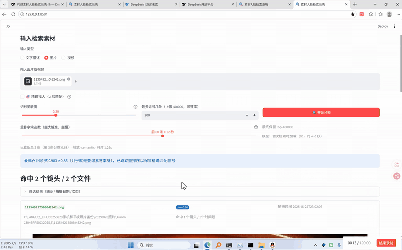

# 演示视频（docs/DEMO.md）

> 一段 35 秒的实操录屏，演示「传图找画面 → 文字找画面」的完整检索链路。

[](media/demo.mp4)

**▶ [点这里看完整视频](media/demo.mp4)**（35.8 秒 / 2870×1790 / 59 fps / 19.1 MB，可直接在浏览器播放或下载）

---

## 时间轴

| 时间 | 画面 | 说明 |
|---|---|---|
| 0:00–0:13 | 搜索页 · **图片** 模式 | 拖入一张图（`1135492_045242.png`，1.7 MB） |
| 0:13–0:19 | 命中结果 | **命中 2 个镜头 / 2 个文件**；最高召回余弦 **0.983**；提示「几乎是查询素材本身，已跳过重排序以保留精确匹配信号」；耗时 **1.2 秒** |
| 0:19–0:30 | 切到 **文字描述** 模式 | 输入「酒吧 男女 相拥」，点「开始检索」（重排序候选 60 条 ≈ 12 秒） |
| 0:30–0:36 | 文字检索结果 | 2 个命中文件；卡片显示 **时间码 `00:00:00 → 00:00:00`、相似度 `sim=0.68/0.67`、完整绝对路径、拍摄时间**；每张卡片带 **▶ 预览 / 找同款 / 📂 打开所在文件夹**；底部可 **导出命中清单（TSV）** |

## 这段视频证明了什么

1. **传图找画面**能精确命中同一素材（cos 0.983），并且系统识别出「这是查询素材本身」，自动跳过重排序，1.2 秒返回
2. **一句话描述**（「酒吧 男女 相拥」）能在库里找到语义对应的画面，即使画面里没有这些文字
3. 命中结果带齐下游动作所需的全部信息：**时间码 + 绝对路径 + 相似度**，三个按钮（预览 / 找同款 / 打开文件夹）直接可用
4. 结果可一键导出 TSV 给下游使用

## 自己复现

```powershell
.\start.bat                       # 打开 http://127.0.0.1:8501
# 搜索页 → 输入类型选「图片」→ 拖入一张库里已有的图 → 开始检索
# 再切「文字描述」→ 输入「酒吧 男女 相拥」→ 开始检索
```

前提：库里已完成 **抽帧 → 画面编码**（否则没有画面向量可检索）。看进度：

```powershell
.venv\Scripts\python.exe tools\status.py
.venv\Scripts\python.exe 12_maintain.py status
```

## 素材文件清单

| 文件 | 用途 | 体积 |
|---|---|---|
| `media/demo.mp4` | 完整演示（可直接播放/下载） | 19.1 MB |
| `media/demo-highlight.gif` | README 顶部的两段高亮拼接（图搜命中 + 文字搜结果） | 2.0 MB |
| `media/demo-preview.gif` | 图搜图命中卡片（含预览/找同款/打开文件夹） | 1.1 MB |
| `media/demo-search.gif` | 文字检索输入与结果 | 2.1 MB |
| `media/demo-poster.jpg` | 封面帧（社交平台预览用） | 60 KB |

## 重新生成预览图（换了视频之后）

```powershell
$ff = "D:\PROGRAM\1_ffmpeg-9.0.1-essentials_build\bin\ffmpeg.exe"

# 封面
& $ff -y -ss 32 -i docs\media\demo.mp4 -frames:v 1 -vf "scale=1280:-1" docs\media\demo-poster.jpg

# 高亮（两段拼接：13.5-17.5s + 30.5-35.8s），820 宽 9fps
& $ff -y -ss 13.5 -t 4 -i docs\media\demo.mp4 -ss 30.5 -t 5.3 -i docs\media\demo.mp4 `
  -filter_complex "[0:v]fps=9,scale=820:-1:flags=lanczos,setsar=1[a];[1:v]fps=9,scale=820:-1:flags=lanczos,setsar=1[b];[a][b]concat=n=2:v=1:a=0,split[x][y];[x]palettegen=stats_mode=diff[p];[y][p]paletteuse=dither=bayer:bayer_scale=5" `
  docs\media\demo-highlight.gif
```

> 经验：GIF 控制在 **3 MB 以内**，超过就降 `fps`（9→6）或宽度（820→640），
> 否则 GitHub/GitCode 的 README 首屏会明显变慢。

## 为什么用 GIF 内嵌而不是 `<video>`

GitHub / GitCode 的 Markdown 渲染器都会**过滤 `<video>` 标签**，直接嵌视频只能看到空白。
可靠做法就是：**GIF 内嵌做预览 + 链接跳转到 mp4**（本页就是这么做的）。
若想要「站内播放」，需要把 mp4 挂在 **Release 附件**里，再用 Release 的下载链接——那样也没有播放器，
只是下载更稳（见 `docs/RUNBOOK.md` 的推送一节）。
